# CF Estates System: Changes Since 30 August 2026

## Contents

- [Bills, invoices and payments](#bills-invoices-and-payments)
- [Budgets](#budgets)
- [Apportionment](#apportionment)
- [Projects and dashboards](#projects-and-dashboards)

**About the links.** Each "Where to see it" link opens the relevant screen in the live system. You need to be signed in, and you will only see screens your role gives you access to.

**About the screenshots.** Most were taken on the test (staging) copy of the system while each change was being checked.

---

## Bills, invoices and payments

### See what has been paid

The Bill Line Items and Invoice Line Items reports now show, for each document, the payments and credit notes matched to it and the total matched amount. Credit notes appear as negative amounts, so they reduce the totals.

**Where to see it:** [Accounting › Vendors › Bill Line Items](https://prettyneat-io-cf-estates-odoo.odoo.com/odoo/action-cf_project_costing.action_account_move_line_bill_items) · [Accounting › Customers › Invoice Line Items](https://prettyneat-io-cf-estates-odoo.odoo.com/odoo/action-cf_project_costing.action_account_move_line_invoice_items)

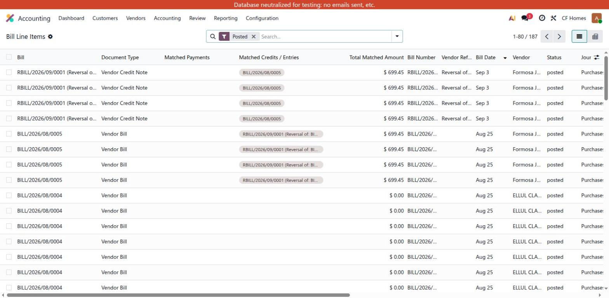

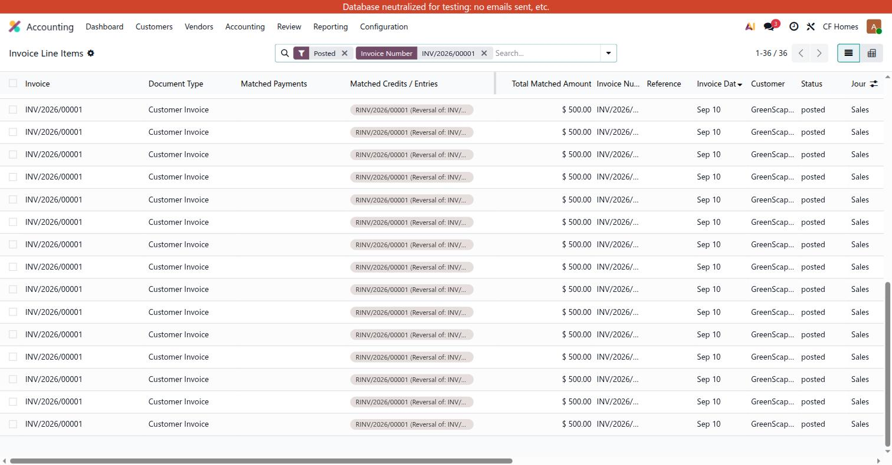

### Enter splits as an amount

When splitting a bill line across units, you can type an amount and the percentage is worked out for you. Below, 2,000 on a 20,000 line becomes 10%.

**Where to see it:** [Accounting › Vendors › Bills](https://prettyneat-io-cf-estates-odoo.odoo.com/odoo/action-account.action_move_in_invoice_type) › open a bill › click the distribution on a line.

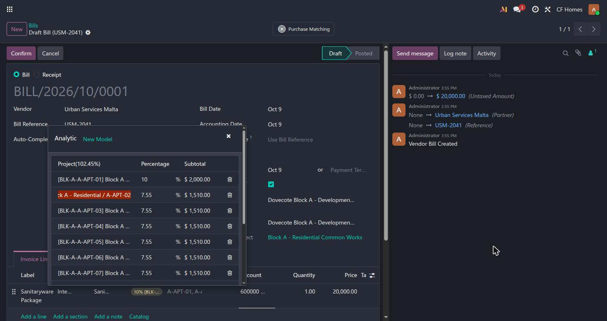

### Warning before changing an agreed split

If a bill line's split comes from an approved apportionment, the system asks what you intend before letting you change it. Saving a changed split needs a reason and Finance Manager rights.

**Where to see it:** [Accounting › Vendors › Bills](https://prettyneat-io-cf-estates-odoo.odoo.com/odoo/action-account.action_move_in_invoice_type) › open a bill linked to a detail line › click the distribution.

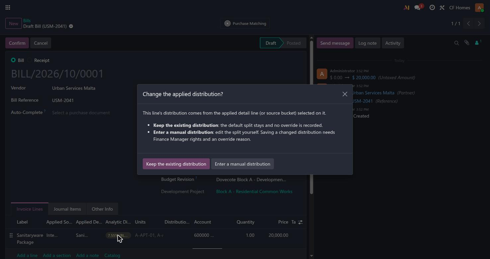

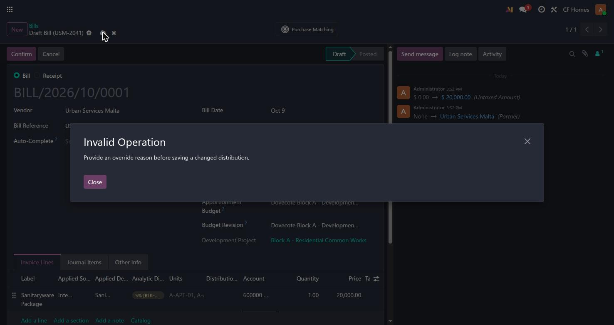

### Bank reconciliation no longer blocked

The "split must total 100%" check now applies only to bills and invoices. Bank statement lines reconcile without that error.

**Where to see it:** Accounting › Dashboard › a bank journal › Reconcile.

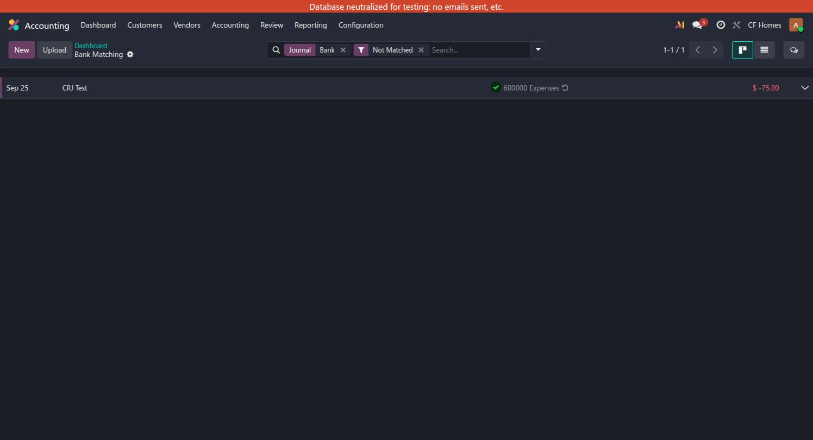

### Tidier customer invoices

The bucket and detail-line columns are hidden on customer invoices, where they are not relevant.

**Where to see it:** [Accounting › Customers › Invoices](https://prettyneat-io-cf-estates-odoo.odoo.com/odoo/action-account.action_move_out_invoice_type) › open an invoice.

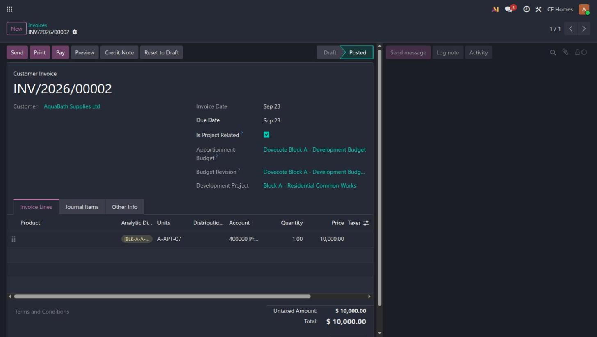

### Finance staff can pick a bucket

Finance and Apportionment Managers no longer get an access error when linking a bill line to a bucket.

**Where to see it:** [Accounting › Vendors › Bills](https://prettyneat-io-cf-estates-odoo.odoo.com/odoo/action-account.action_move_in_invoice_type) › open a bill › choose a Source Bucket on a line.

### No more "100.03%" refusals

Rounding could make a default split add up to slightly over or under 100%, which stopped the bill from being posted. The split now always totals exactly 100%.

A draft bill saved before this fix keeps its old split. Re-select its Source Bucket or Detail Line once to refresh it.

**Where to see it:** [Accounting › Vendors › Bills](https://prettyneat-io-cf-estates-odoo.odoo.com/odoo/action-account.action_move_in_invoice_type) › post a project-related bill.

The screenshot shows the refusal as it was **before** the fix:

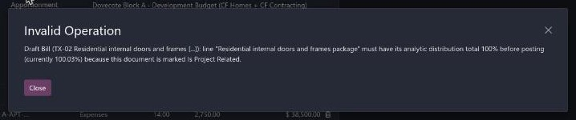

### Clearer message for a missing detail line

A bill or purchase order line on a broken-down bucket with no detail line chosen now gets a plain message naming the bucket, not a technical error.

**Where to see it:** [Accounting › Vendors › Bills](https://prettyneat-io-cf-estates-odoo.odoo.com/odoo/action-account.action_move_in_invoice_type) › on a bill line, choose a broken-down Source Bucket and leave Detail Line empty.

### Whole-development costs are tracked

A cost charged to the whole development, not to individual units, now shows on the Common Works project as "Common Works Direct Unclassified".

**Where to see it:** [CF Apportionment › Reporting › Linked Actuals](https://prettyneat-io-cf-estates-odoo.odoo.com/odoo/action-cf_project_costing.action_cf_reporting_linked_actuals)

---

## Budgets

### Export to Excel

Budgets and budget revisions have an **Export Excel** button. The workbook covers the budget, its revisions, line items and approvals, including the project start and end dates.

**Where to see it:** [CF Budget › Budgets](https://prettyneat-io-cf-estates-odoo.odoo.com/odoo/action-cf_budget.action_cf_budgets) › open a budget › Export Excel. Also on [CF Budget › Revisions](https://prettyneat-io-cf-estates-odoo.odoo.com/odoo/action-cf_budget.action_cf_budget_revisions).

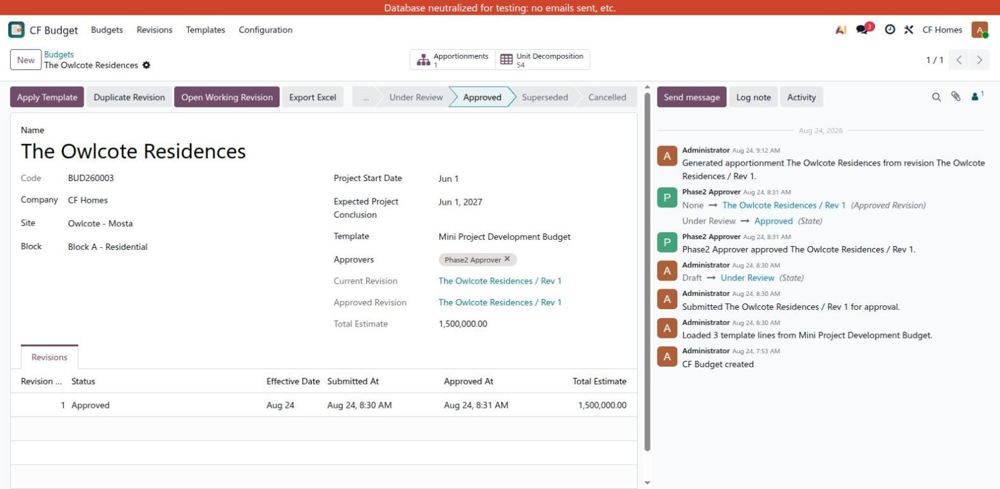

### Block is optional

A budget can cover a whole site without choosing a block. Units still need a block, because a unit is a physical property in a specific block.

**Where to see it:** [CF Budget › Budgets](https://prettyneat-io-cf-estates-odoo.odoo.com/odoo/action-cf_budget.action_cf_budgets) › New.

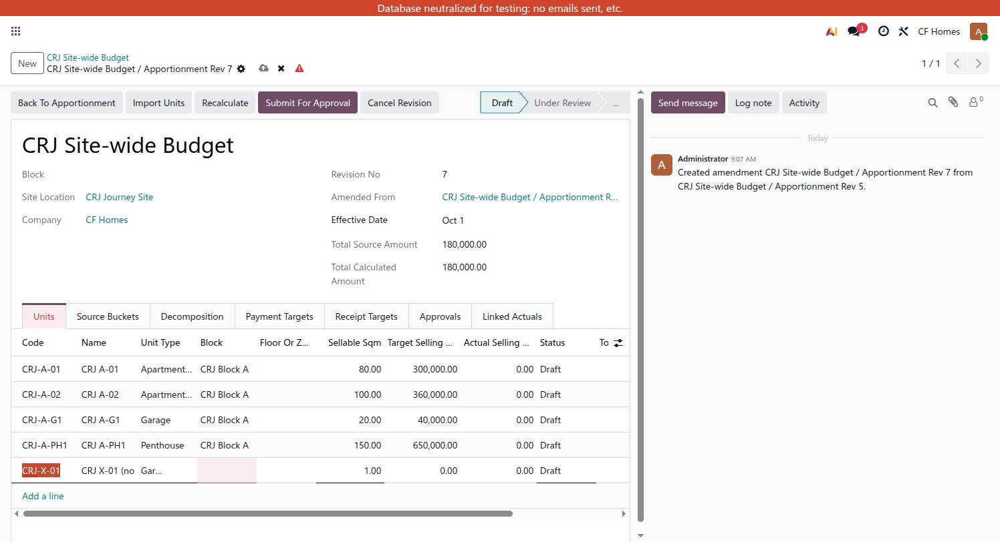

### Clearer labels

"Site" is now "Site Location", and the free-text column is "Description" on both budget lines and Source Buckets. Hovering over "Trade" explains what it is for, on budget lines, Source Buckets and Detail Lines.

**Where to see it:** [CF Budget › Revisions](https://prettyneat-io-cf-estates-odoo.odoo.com/odoo/action-cf_budget.action_cf_budget_revisions) › open a revision. Also [CF Apportionment › Reporting › Source Buckets](https://prettyneat-io-cf-estates-odoo.odoo.com/odoo/action-cf_apportionment.action_cf_reporting_source_lines).

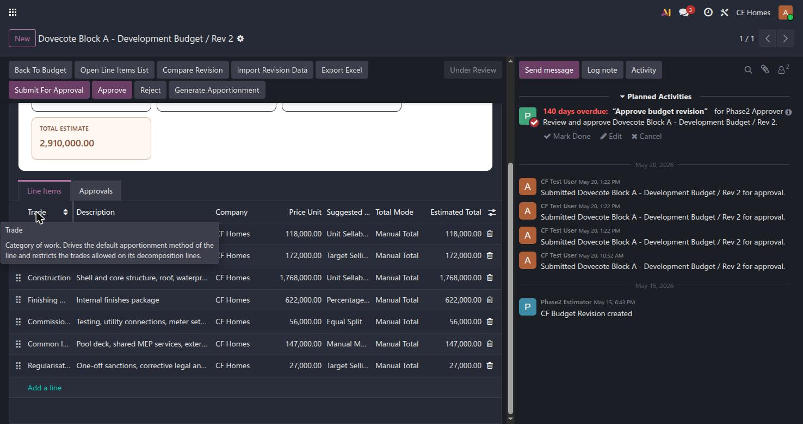

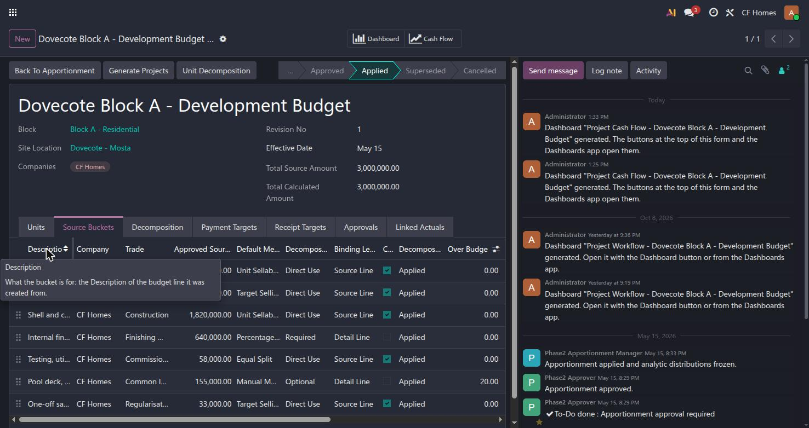

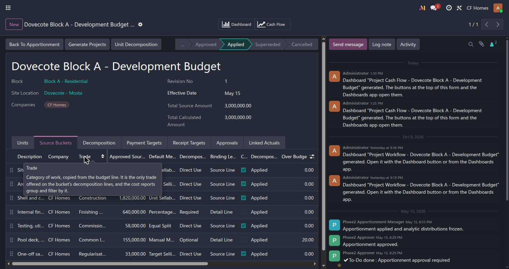

### Two companies in one budget

Each budget line is marked as CF Homes or CF Contracting, so one development budget can hold both companies' costs.

- A bill can only be charged to its own company's lines.
- Staff with access to one company see only that company's lines.
- Reports and the allocation workbook show and filter by company.
- Estimators and approvers must have access to both companies.

**Where to see it:** [CF Budget › Budgets](https://prettyneat-io-cf-estates-odoo.odoo.com/odoo/action-cf_budget.action_cf_budgets) › open a budget › Company column on each line. Company totals are on [CF Apportionment › Cost Report Lines](https://prettyneat-io-cf-estates-odoo.odoo.com/odoo/action-cf_project_costing.action_cf_cost_report_lines).

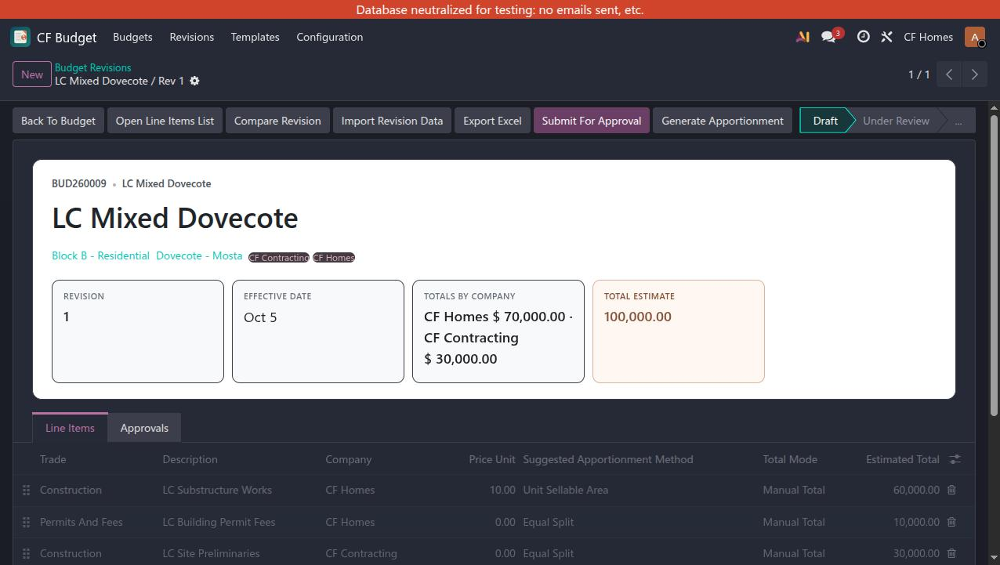

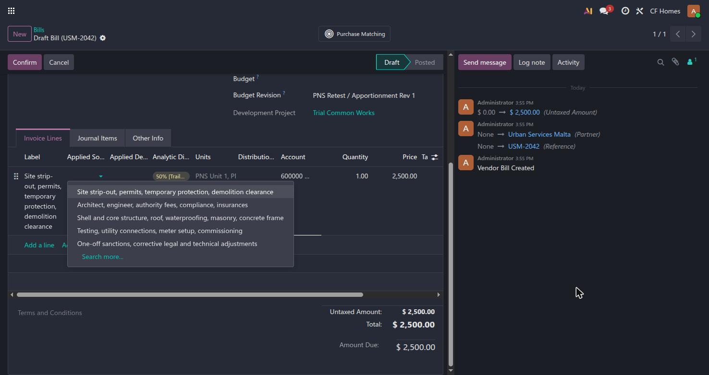

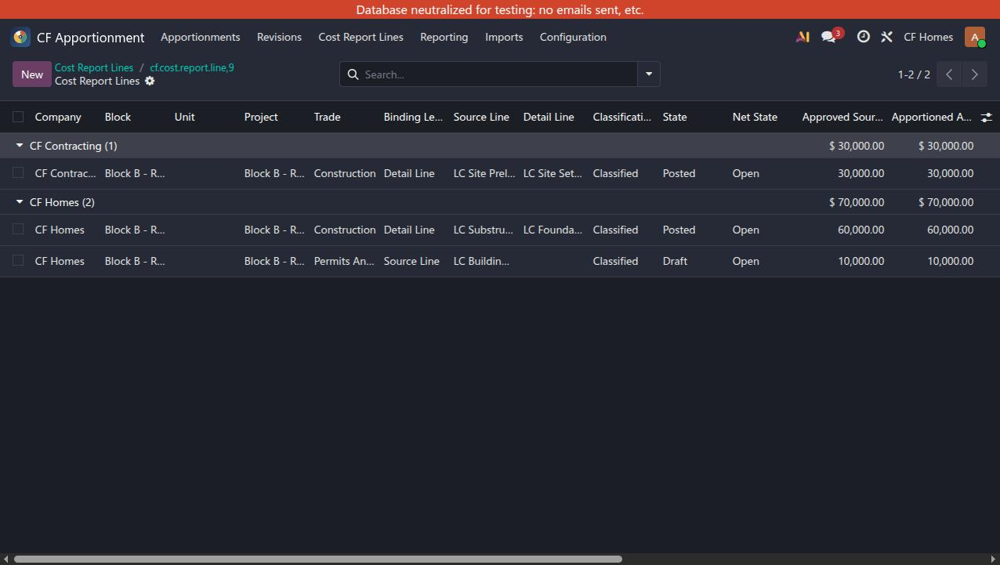

---

## Apportionment

Unless stated otherwise, these are seen at [CF Apportionment › Revisions](https://prettyneat-io-cf-estates-odoo.odoo.com/odoo/action-cf_apportionment.action_cf_apportionment_revisions) › open a revision.

### Unit names must be unique

No two units anywhere in the system can share a name, and names and codes cannot be blank.

**Where to see it:** [CF Apportionment › Reporting › Units](https://prettyneat-io-cf-estates-odoo.odoo.com/odoo/action-cf_apportionment.action_cf_reporting_units), or the Units tab of a revision.

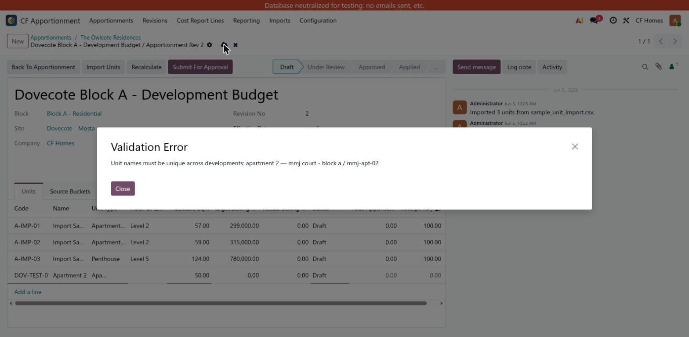

### Description and Trade on Source Buckets

The Source Bucket column that was called "Name" is now "Description", the same as on the budget line it comes from. Hovering over Description or Trade explains what each is for. More under [Clearer labels](#clearer-labels) in the Budgets section.

**Where to see it:** open a revision › Source Buckets tab.

### Group lines add themselves up

A group line no longer needs a method. Its amount is the sum of the lines beneath it, and totals never count a group and its children twice.

**Where to see it:** open a revision › Decomposition tab.

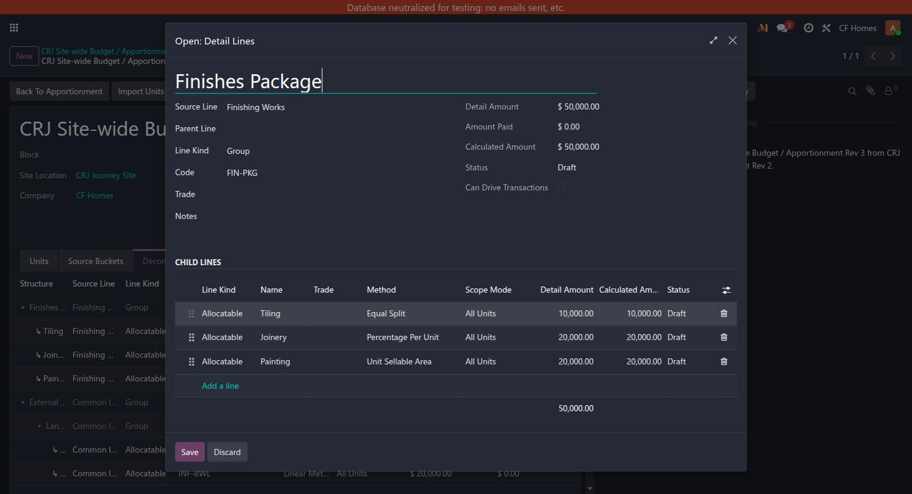

### Clearer breakdown layout

Detail lines are shown indented as a hierarchy, with one extra level of nesting allowed.

**Where to see it:** open a revision › Decomposition tab, or [CF Apportionment › Reporting › Decomposition](https://prettyneat-io-cf-estates-odoo.odoo.com/odoo/action-cf_apportionment.action_cf_reporting_detail_lines).

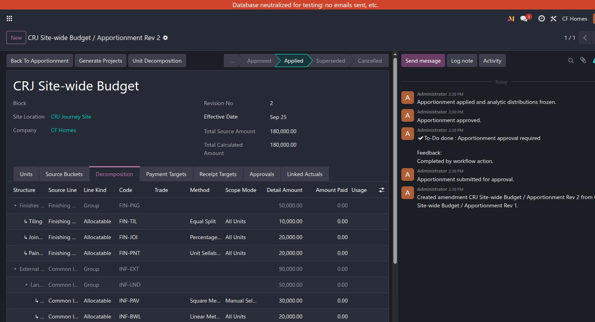

### Amend without a new budget revision

An approved apportionment can be amended on its own with **Amend Apportionment**. An unwanted amendment can be cancelled with **Cancel Revision**, which puts the previous revision back in force. Amounts already paid carry over into the amendment.

**Where to see it:** open an approved or applied revision › Amend Apportionment.

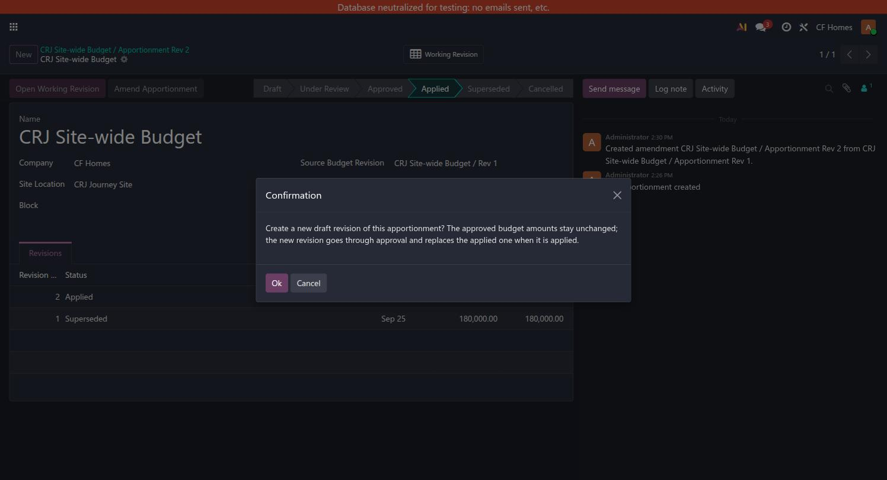

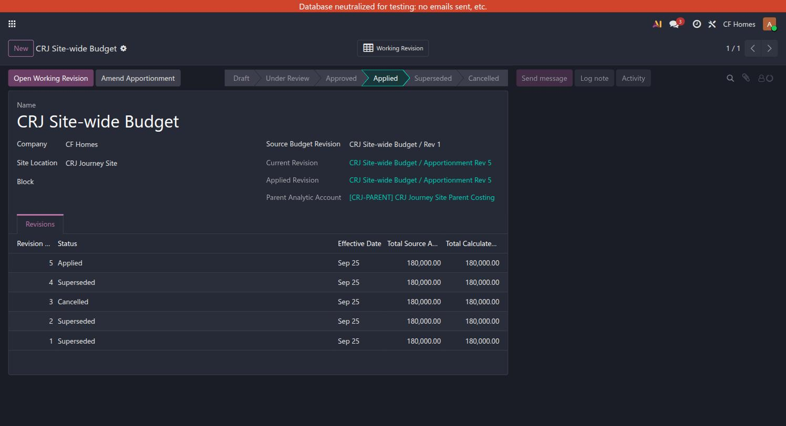

### New ways to split costs

Costs can be split by square metres per unit or linear metres per unit.

**Where to see it:** open a revision › Decomposition tab › open a detail line › Method.

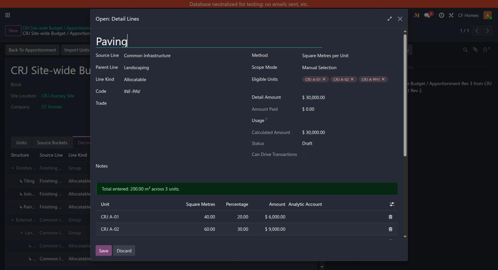

### Live feedback when allocating

Unit rows appear straight away, with a running "left to allocate" figure. A display fault where the last unit absorbed any unallocated share has been corrected.

**Where to see it:** open a revision › Decomposition tab › open a per-unit detail line.

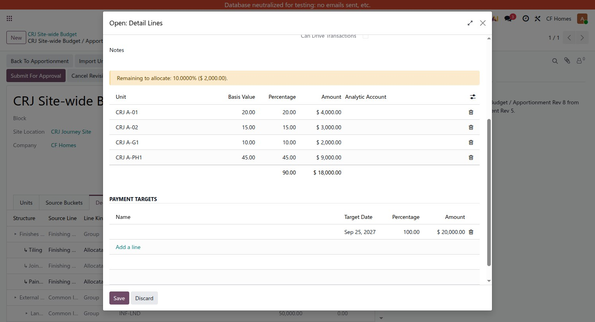

### Unit status: POS and Deed

The unit Status list is now Draft, Active, Reserved, **POS**, **Deed**, Archived. POS (promise of sale) is new. Deed replaces Sold, and units marked Sold become Deed automatically.

- The status now belongs to the unit, not to one revision. Change it once and every revision of that unit shows it.
- It can be changed at any time, including after the revision is applied, without an amendment.
- In a units import file, a blank status now keeps the status the unit already has. It used to set the unit back to Draft. Files that still say `sold` are accepted.

**Where to see it:** [CF Apportionment › Reporting › Units](https://prettyneat-io-cf-estates-odoo.odoo.com/odoo/action-cf_apportionment.action_cf_reporting_units) › click a unit's row › Status. On a Draft revision, the Units tab works as before.

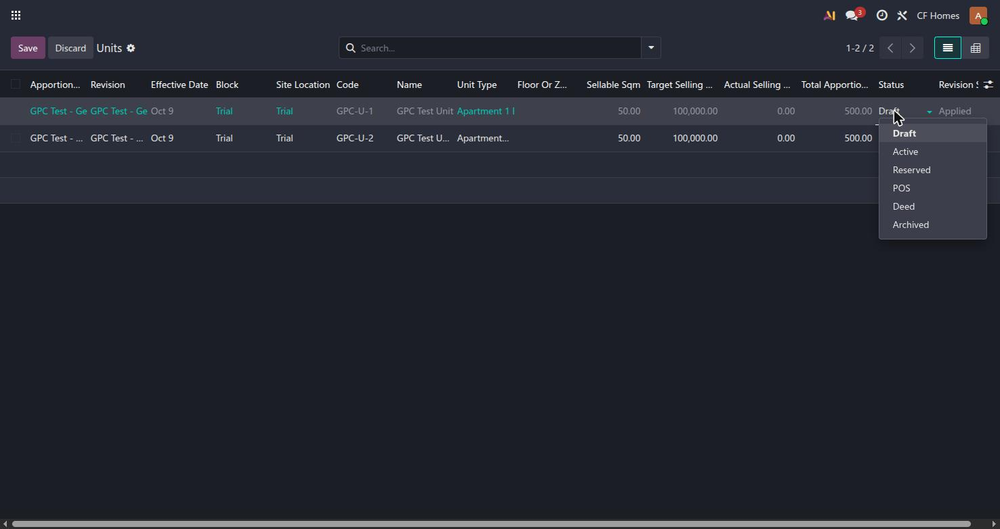

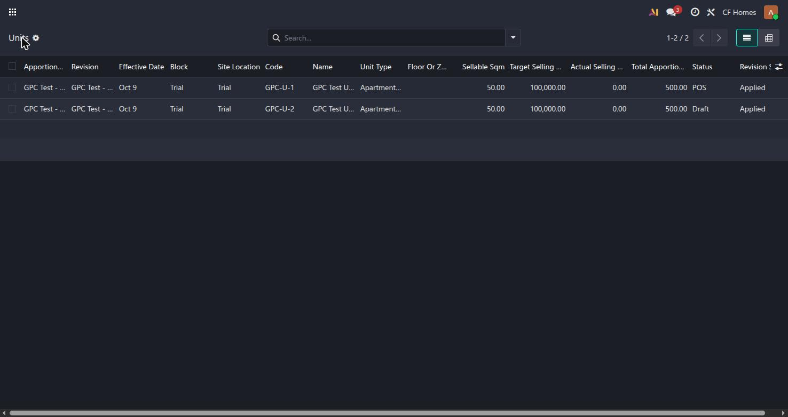

### Notes and files on detail lines

Each detail line has its own notes area. Attached files are filed automatically into the project's Documents folder.

**Where to see it:** open a revision › Decomposition tab › open a detail line. Filed documents are in [Documents](https://prettyneat-io-cf-estates-odoo.odoo.com/odoo/action-documents.document_action).

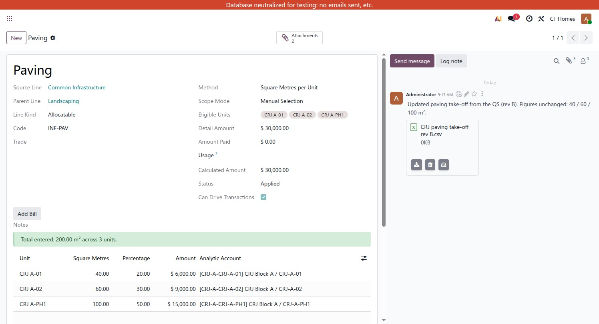

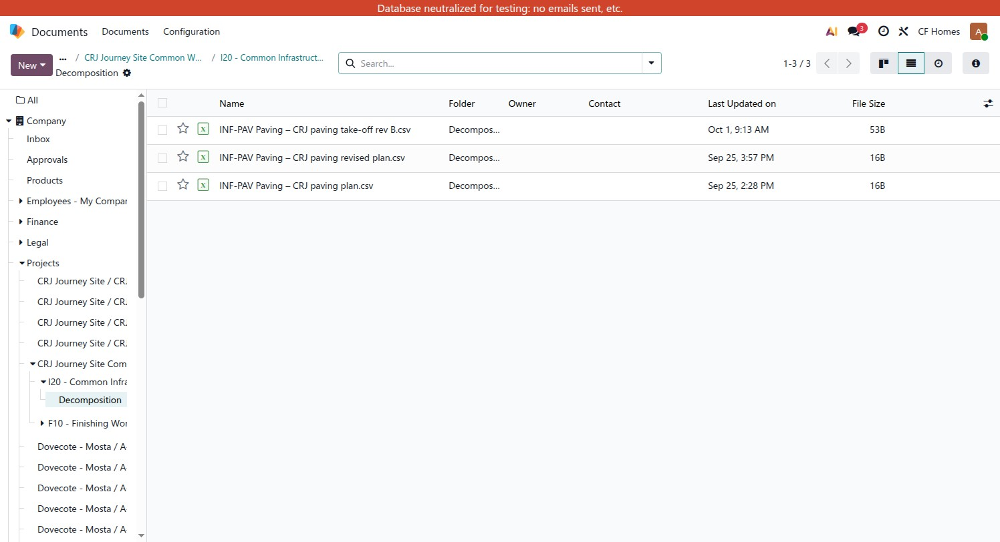

### Usage status

A detail line is marked **Done** automatically once money is paid against it. It can be marked **N/A** by hand if it is not needed on the project.

**Where to see it:** open a revision › Decomposition tab › Usage column.

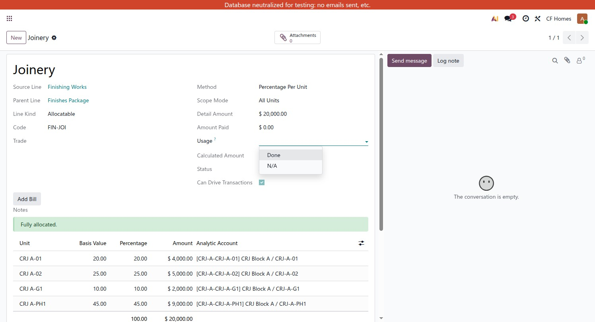

---

## Projects and dashboards

Unless stated otherwise, these start at [CF Apportionment › Revisions](https://prettyneat-io-cf-estates-odoo.odoo.com/odoo/action-cf_apportionment.action_cf_apportionment_revisions) › open an applied revision › **Generate Projects**.

### Dashboards created automatically

Generate Projects now also publishes two dashboards for the development: a project financial dashboard and a Project Cash Flow dashboard.

**Where to see it:** [Dashboards](https://prettyneat-io-cf-estates-odoo.odoo.com/odoo/action-spreadsheet_dashboard.ir_actions_dashboard_action), or the dashboard buttons on the revision.

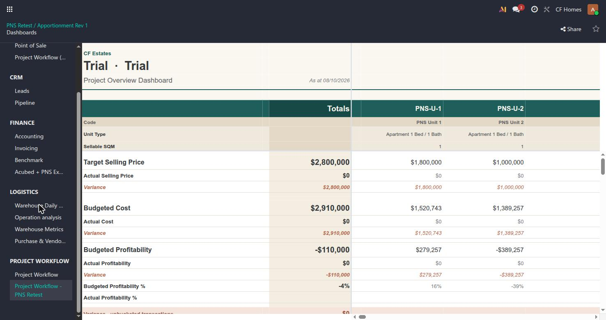

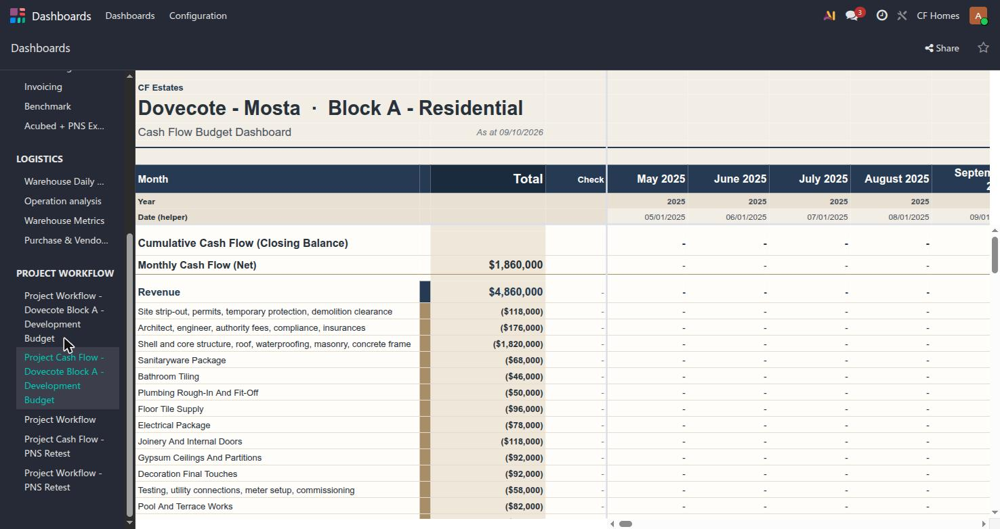

### Progress window

Generate Projects shows what is being created and roughly how long it will take.

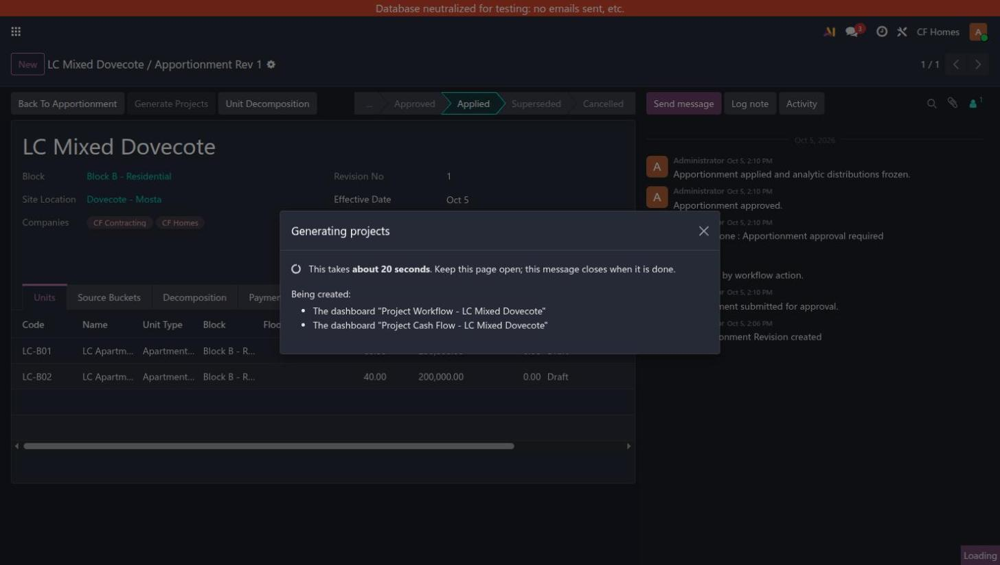

### Ready-made projects

Generated projects now start from a template with standard tasks and are visible to all internal staff. Existing generated projects were updated to match.

- Each project has a CF Estates tab showing its apportionment, revision, unit and OneDrive path.
- Each project has a Documents button.
- The Common Works project has a Units button.

**Where to see it:** [Project](https://prettyneat-io-cf-estates-odoo.odoo.com/odoo/action-project.open_view_project_all) › open a generated project.

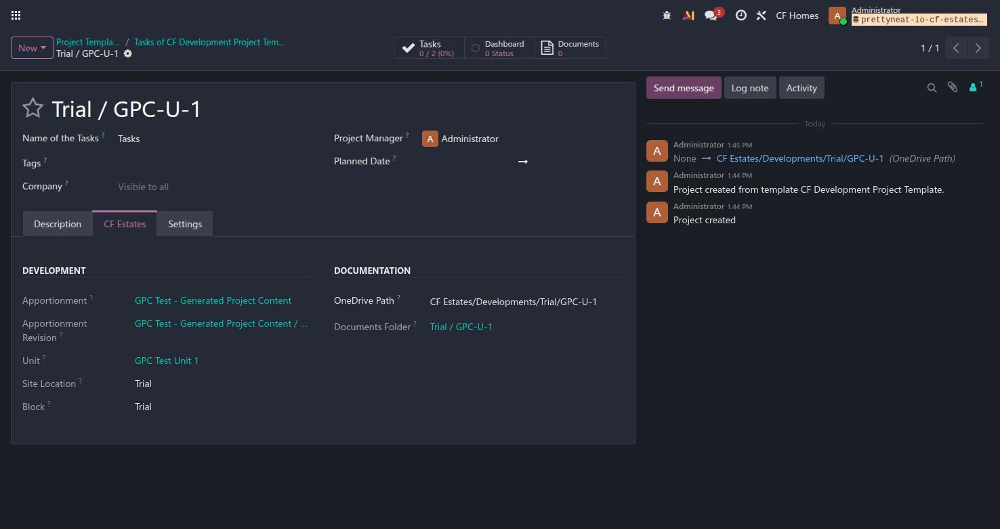

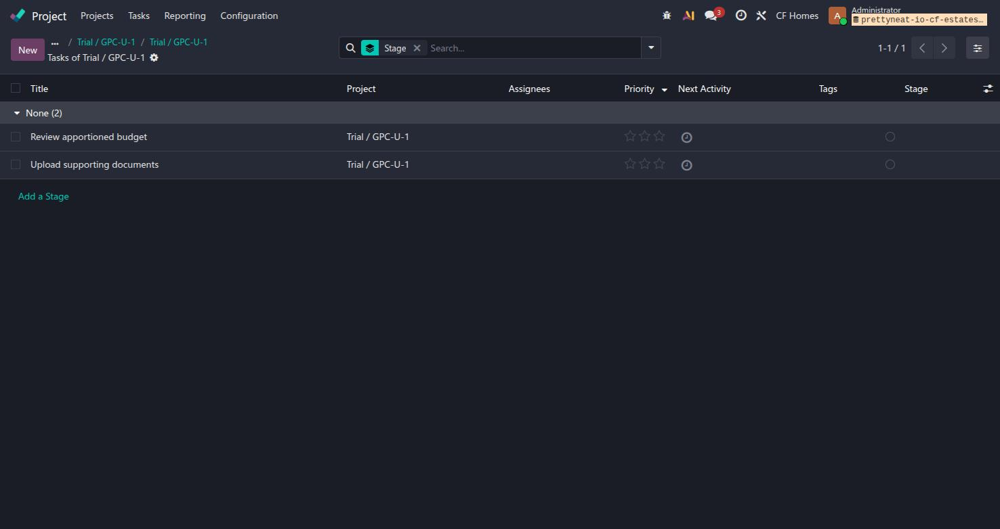

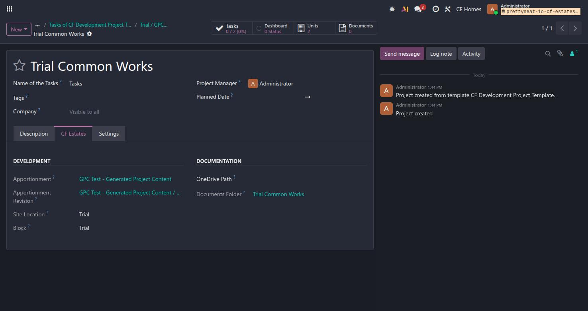
