# Panino Mobile UI Spec

18 October 2026 · Kris

## Summary

Panino's phone layout (viewports under 768 px) moves from a squeezed desktop layout to a capture-first card grid home and a single-pane editor with a Write / Preview switch. The desktop layout is unchanged.

**Goals**

- A new note is one tap from anywhere and lands in an Inbox, filed later.
- Notes are visible on the first screen, with no navigation step first.
- Phone screens show one pane at a time, never editor and preview stacked.
- App chrome takes at most one bar at the top; frequent actions sit within thumb reach at the bottom.
- Sync, collaboration and PDF export stay fully available, but move into menus and sheets.

**Design principles**

1. **Content is the home screen.** Cards show stripped, readable previews, not markdown syntax.
2. **One thing at a time.** One pane, one sheet, one primary action per screen.
3. **Thumbs first.** Create, save and edit controls live in the bottom third.
4. **Status is passive.** Sync shows as a dot and a word, not a button in the toolbar.
5. **Markdown stays honest.** Write mode shows the source; Preview shows the result; nothing hides the syntax from people who want it.

**What changes from the current mobile UI**

| Today | New |
| --- | --- |
| Six unlabelled icons plus two rows of pane toggles (about 25% of the screen) | One search bar on Home; one back / title / ⋯ bar in the editor |
| Editor and Preview can be on together, stacking the same text twice | Write / Preview segmented switch, one pane at a time |
| Expanding folder tree as the documents view | Drawer with folders; drill-down folder screens |
| Snippets show raw markdown (`# First Document # 30-09-26…`) | Snippets stripped to plain text, checklists previewed as ticks |
| Collaborate bar mid-screen while editing | Collaborate lives in the document ⋯ menu; presence shows as avatars in the top bar |
| Dark mode and sync as top-level buttons | Appearance in Settings and the ⋯ menu; sync as a status dot |

Mockups are 390 × 844 (iPhone 14/15 size). The interactive versions live on the [Panino Mobile Redesign canvas](https://claude.ai/artifact/RProTe744wDWbaYG1XLijp). Values in [brackets] are placeholders, not designs.

## Navigation

Home is the only root screen on phones; there is no bottom tab bar. Everything else is reached from Home's top pill, its bottom bar, a card, or the Drawer.

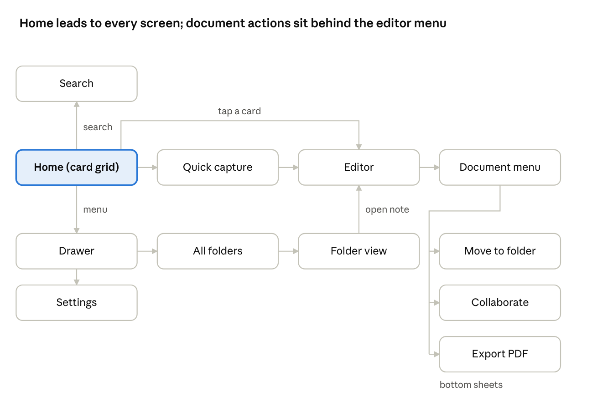

The Home avatar also opens Settings directly. Sheets (Quick capture, Document menu, Move, Collaborate, Export) open over the current screen and close back to it; full screens push onto history so the back gesture walks back one step at a time.

| Route | Screen | Opened from |
| --- | --- | --- |
| `/` | Home | App launch, back from any screen |
| `/search` | Search | Home search pill, folder search icon |
| `/folders` | All folders | Drawer → See all, Shared chip |
| `/folders/:id` | Folder view | Drawer, All folders, Inbox chip, breadcrumb |
| `/notes/:id` | Editor | Any card, search result, Capture Save |
| `/settings` | Settings | Home avatar, Drawer |
| `?sheet=capture \| menu \| move \| collaborate \| export` | Sheets | Bottom bar, ⋯, document menu rows |

## Screens

Fourteen screens make up the phone flow; each heading matches an artboard name on the canvas.

### Home — card grid / list

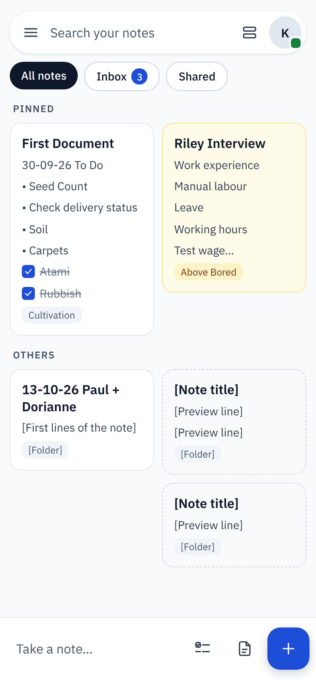 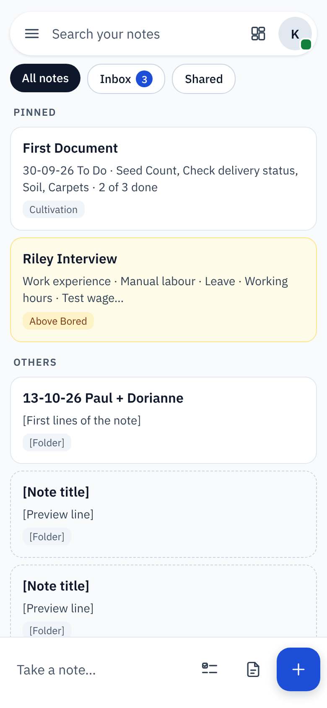

*Grid view (default) and list view.*

- **Top:** one floating search pill (52 px, radius 26). Left: menu button opens the Drawer. Middle: "Search your notes" opens Search. Right: grid/list toggle, then the avatar, which opens Settings and carries the sync dot.
- **Filter chips** under the pill: All notes (default), Inbox with an unread-style count, Shared.
- **Sections:** Pinned, then Others. Each sorted by last modified, newest first.
- **Grid view:** two columns, 10 px gap, cards keep their natural height (masonry; items fill the shorter column).
- **List view:** one column, each card shows title, a one-line stripped summary and the folder chip.
- **Card content (grid):** title; up to 8 preview lines of stripped text; ticked checklist items shown struck through; folder chip at the foot. Long notes truncate with an ellipsis, never a scrollbar.
- **Bottom bar** (76 px, fixed): "Take a note…" opens Capture; checklist icon opens Capture in Checklist mode; template icon opens the template picker; the primary + button opens Capture.
- **Long-press a card:** enters multi-select with a contextual top bar (Pin, Move, Colour, Trash).

### Drawer

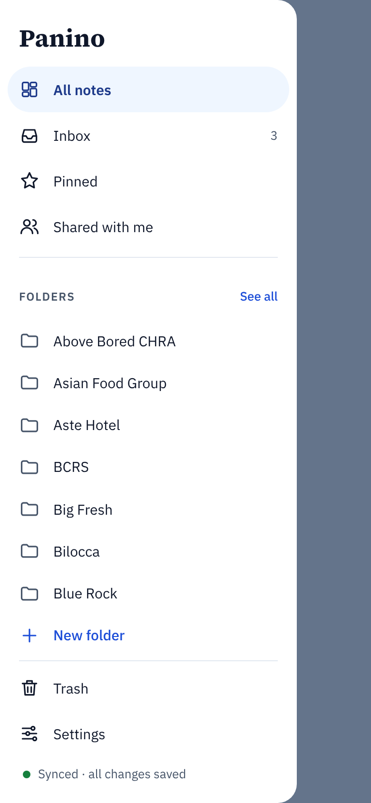

- Slides in from the left, 312 px wide, scrim over the rest; tap the scrim or swipe left to close.
- Items: All notes, Inbox (count), Pinned, Shared with me.
- **Folders:** top-level folders, alphabetical, max 7 shown, then "See all" (All folders) and "New folder".
- Footer: Trash, Settings, and a passive sync line ("Synced · all changes saved").

### Search

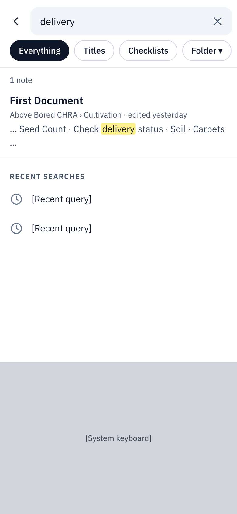

- Full screen; keyboard opens immediately with focus in the field.
- Scope chips: Everything, Titles, Checklists, Folder.
- Results: title, folder path and edited time, then a snippet with the match highlighted.
- Results update as you type (debounced 150 ms). With an empty query, show recent searches.
- Opened from inside a folder, the Folder chip is pre-set to that folder.

### Folder view

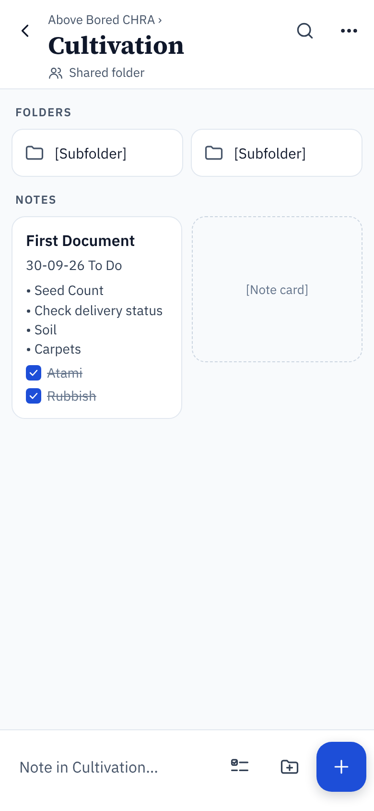

- Header: back, breadcrumb of parent folders (tappable), folder name in the serif display face, "Shared folder" when shared, search-in-folder, ⋯ for folder options (rename, move, share, delete).
- Subfolders first as a two-up row of tiles, then notes in the same card grid as Home.
- Bottom bar placeholder reads "Note in &lt;folder&gt;…"; capture from here saves into this folder, not the Inbox. A third button creates a subfolder.

### Quick capture

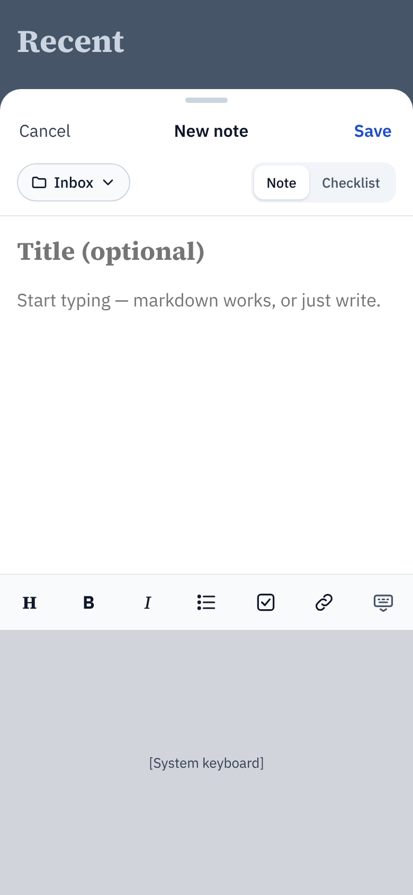

- Bottom sheet, 760 px tall, opens with the keyboard up and focus in the body.
- Header: Cancel / New note / Save. Swipe down or Cancel with content asks "Discard note?"
- Destination chip defaults to Inbox (or the current folder); tap to change.
- Note / Checklist switch. Checklist mode starts the body with `- [ ] `.
- Title is optional. With no title, the first line becomes the title.
- Markdown key row above the keyboard (heading, bold, italic, list, checkbox, link, hide keyboard).
- Save opens the new note in the Editor in Write mode.

### Editor — Write / Preview

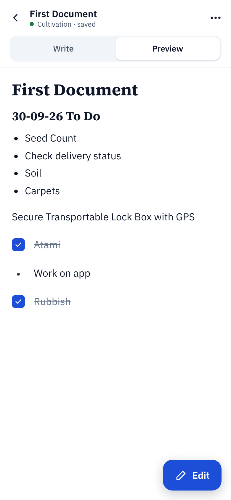 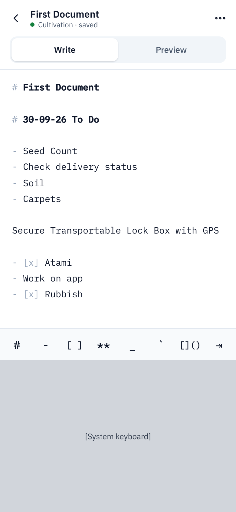

*Preview (default for existing notes) and Write.*

- **Top bar** (60 px): back; title with folder and save status underneath; ⋯ opens the Document menu.
- **Mode switch** under the bar: Write | Preview. Existing notes open in Preview; new notes open in Write. The setting "Open notes in" overrides this.
- **Write:** monospace source, markdown markers in a muted colour, key row (`#` `-` `[ ]` `**` `_` `` ` `` `` `⇥`) docked above the keyboard.
- **Preview:** rendered document. Checkboxes are tappable and write `[x]` / `[ ]` back to the source. An "Edit" floating button switches to Write.
- Headings on phones: H1 28 px, H2 21 px, body 17 px (today's H1 takes about 40% of the first screen).
- Never show Write and Preview at the same time below 768 px.

### Editor — live collaboration

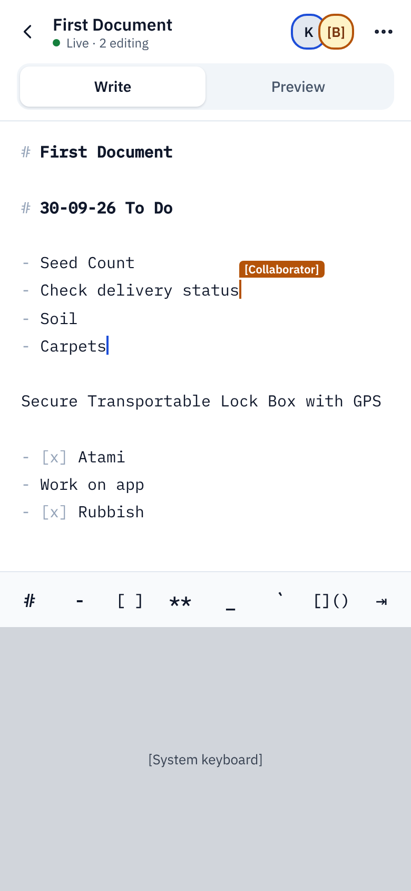

- Status line reads "Live · 2 editing"; stacked avatars appear left of ⋯ and open Collaborate.
- Remote cursors show as a coloured caret with the person's name flag; each collaborator gets a stable colour.
- Solo notes show no avatars and no collaboration UI in the editor.

### Document ⋯ menu

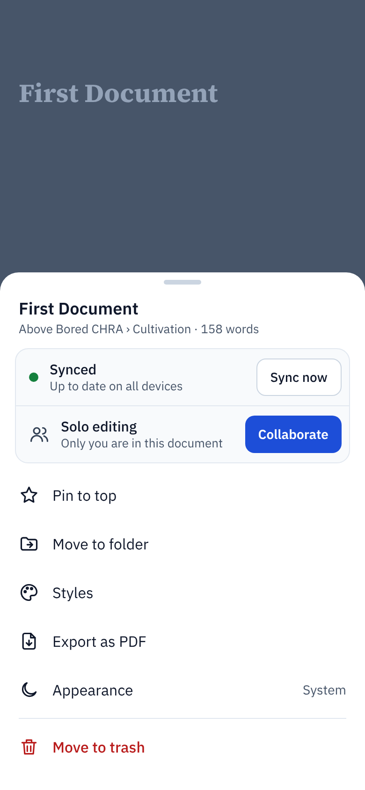

- Bottom sheet. Header: title, folder path, word count.
- Status card: sync state with "Sync now"; collaboration state ("Solo editing") with a Collaborate button.
- Actions: Pin to top, Move to folder, Styles, Export as PDF, Appearance, then Move to trash in red, separated.

### Move to folder

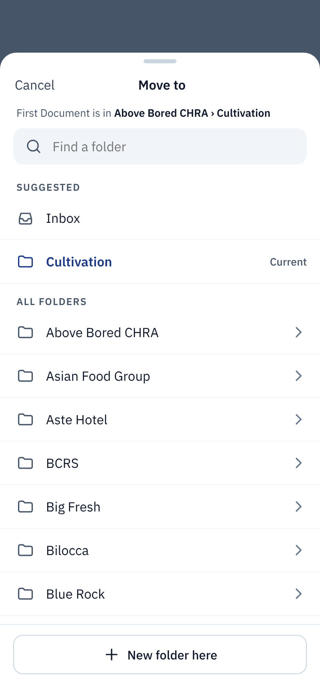

- Sheet titled "Move to", stating the note's current location.
- Find-a-folder field; Suggested (Inbox, current folder marked "Current"); All folders.
- Tap a row to move immediately and close; the chevron drills into subfolders. "New folder here" at the foot.
- After moving, show a toast "Moved to &lt;folder&gt;" with Undo for 5 s.

### Collaborate

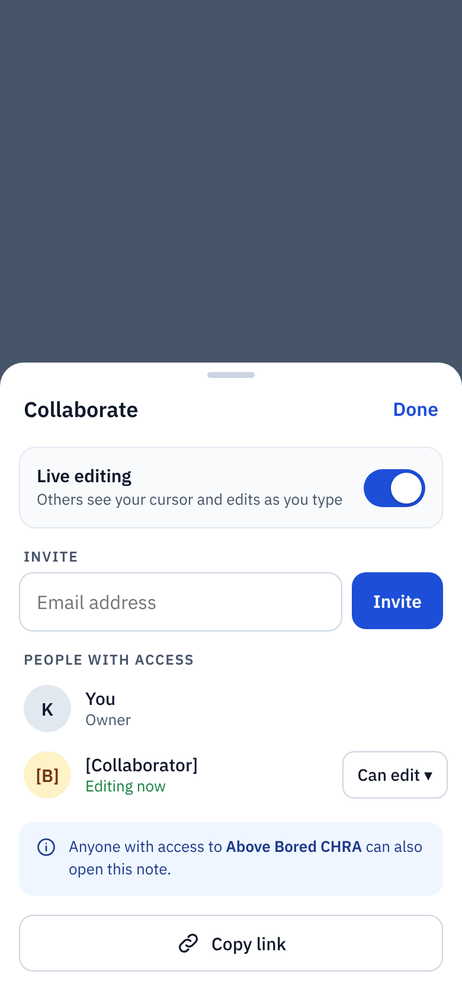

- Live editing switch with a one-line explanation.
- Invite by email; people with access with role (Owner, Can edit, Can view) and live presence ("Editing now").
- Inherited-access notice when the note sits in a shared folder; Copy link at the foot.

### Export PDF

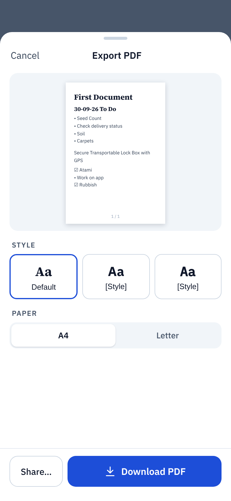

- Sheet with a page-1 preview that updates when style or paper changes.
- Style picker (three tiles with an "Aa" sample), paper A4 (default) or Letter.
- Primary "Download PDF"; secondary "Share…" opens the system share sheet. Show progress on the primary button while the server renders.

### All folders

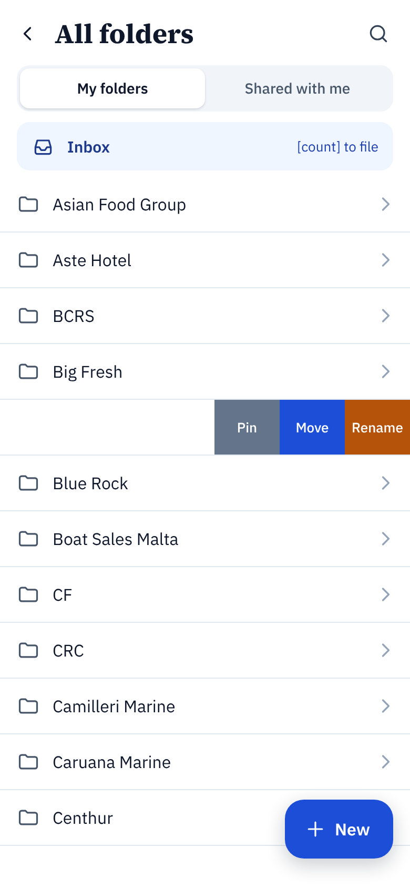

- Back to the Drawer; My folders | Shared with me switch; Inbox pinned at the top with its count.
- Rows drill into Folder view. Swipe left on a row reveals Pin, Move, Rename (shown on one row in the mockup).
- "New" floating button creates a folder (or a note when inside one).

### Settings

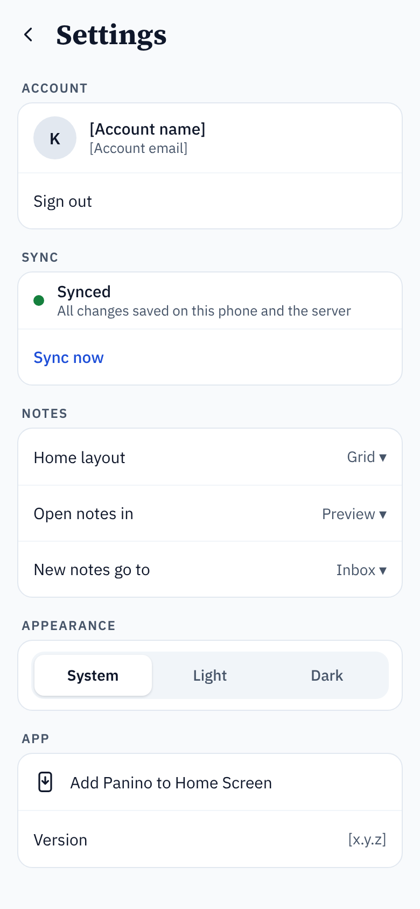

- Account (name, email, Sign out); Sync (status, Sync now); Notes (Home layout, Open notes in, New notes go to); Appearance (System / Light / Dark); App (Add Panino to Home Screen, version).

### Home — empty and offline

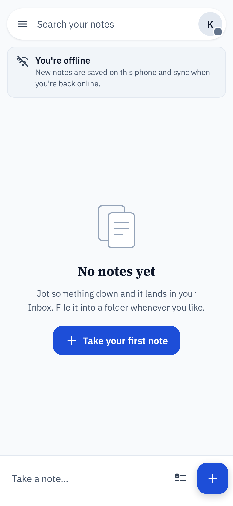

- **Empty:** illustration, "No notes yet", one line on the Inbox, and a "Take your first note" button.
- **Offline:** a status banner under the search pill ("You're offline … sync when you're back online") and a grey sync dot on the avatar. Everything stays editable offline.

## Visual system

The mockups keep Panino's existing blue and serif headings and add a small token set; swap the fonts if the app already ships others.

**Type**

| Role | Face | Size / weight |
| --- | --- | --- |
| Screen title (Home sections excepted) | Source Serif 4 | 26–30 px / 700 |
| Document H1 / H2 (Preview) | Source Serif 4 | 28 / 21 px, 700 |
| Body, Preview text | IBM Plex Sans | 17 px / 400, line height 1.5 |
| Card title | IBM Plex Sans | 16 px / 600 |
| Card preview line | IBM Plex Sans | 14 px / 400 |
| Section label (PINNED, OTHERS) | IBM Plex Sans | 12 px / 600, tracking 0.08 em |
| Write mode source | IBM Plex Mono | 15 px / 400, line height 1.75 |

**Colour tokens (light)**

| Token | Value | Use |
| --- | --- | --- |
| `ink` | #0f172a | Primary text |
| `ink-2` | #334155 | Card previews, icons |
| `muted` | #475569 | Secondary text, labels (passes 4.5:1 on white and #f8fafc) |
| `line` | #e2e8f0 | Borders, dividers |
| `surface` | #ffffff | Cards, sheets, editor |
| `canvas` | #f8fafc | Home and folder backgrounds |
| `accent` | #1d4ed8 | Primary buttons, ticks, active states |
| `accent-soft` | #eff6ff | Active drawer item, info notices |
| `ok` | #15803d | Synced dot |
| `danger` | #b91c1c | Trash |
| `note-sand` | #fefce8 / #fde68a | Example card colour (fill / border) |

Dark theme mirrors each token; design it alongside, not after.

**Spacing and shape:** 4 px grid; screen gutters 12 px (Home) and 16–20 px (sheets, editor); card radius 14, sheet radius 20, buttons 12–16, chips 17. Touch targets at least 44 × 44 px.

**Components to build once and reuse**

- Note card (grid and list variants, colour tones, pinned flag)
- Bottom sheet (grab handle, header with Cancel / title / action, swipe to dismiss)
- Segmented control (Write/Preview, paper size, theme, folder scope)
- Markdown key row (two variants: symbol keys for Write, formatting icons for Capture)
- Filter chip, folder chip, sync dot, avatar stack
- Bottom capture bar
- Toast with Undo

## Behaviour

**Breakpoint.** This layout applies below 768 px wide. At 768 px and up, the current desktop layout stays as is.

**Sync and offline.** Sync status is shown, never asked for. States and where they appear:

| State | Avatar dot | Editor status line | Other |
| --- | --- | --- | --- |
| Synced | Green | "&lt;folder&gt; · saved" | Drawer footer "Synced · all changes saved" |
| Syncing | Green, pulsing | "Saving…" | — |
| Offline | Grey | "Saved on this phone" | Banner on Home until back online |
| Live collaboration | Green | "Live · N editing" | Avatar stack in editor top bar |
| Sync error | Amber | "Not synced — tap to retry" | Status card in ⋯ menu shows the error |

CR-SQLite merges concurrent edits, so there is no conflict dialog; the UI never blocks editing on sync.

**Snippet stripping.** Card and search previews strip markdown before display: drop `#` markers, list markers become bullets, `- [x]` items render as ticked lines, links show their text, code fences and images are skipped. Strip once on save and store the result with the note, so lists render without parsing.

**Checkboxes in Preview.** Tapping a box toggles `[ ]` / `[x]` on that exact source line, saves immediately and does not move to Write mode.

**Keyboard.** The key row docks to the top of the on-screen keyboard (use `visualViewport` resize events). Bottom sheets resize with the keyboard so the primary action stays visible. Hide-keyboard is always available in the key row.

**Gestures**

| Gesture | Where | Result |
| --- | --- | --- |
| Tap card | Home, Folder view, Search | Open note in default mode |
| Long-press card | Home, Folder view | Multi-select mode |
| Swipe left on row | All folders, Move picker | Pin, Move, Rename |
| Swipe down on sheet | Any sheet | Dismiss (with discard check if content changed) |
| Edge swipe from left | Home | Open Drawer |
| Pull down | Home | Sync now |

**Navigation history.** Each screen and sheet pushes a history entry, so the browser and system back gesture close sheets first, then go back a screen.

**PWA.** Ship a web app manifest (standalone display, theme colour, icons) and a service worker that caches the app shell, so Panino installs to the Home Screen and opens without browser bars. Settings carries the install prompt.

## Accessibility

The target is WCAG 2.2 AA on iOS Safari with VoiceOver and Android Chrome with TalkBack.

- Every tappable control is a real `<button>` or `<a>`, at least 44 × 44 px; icon-only buttons carry an `aria-label` ("Open menu and folders", "Switch to list view").
- Text contrast at least 4.5:1; muted text uses #475569, never lighter, on white or #f8fafc.
- Segmented controls and chips expose `aria-pressed`; switches use `role="switch"` with `aria-checked`.
- Sheets and the Drawer are dialogs: focus moves in on open, is trapped while open, and returns to the opener on close; Escape and back close them.
- Preview checkboxes announce "Mark done: Atami" / "Mark not done: Atami" and their state.
- Sync and offline changes announce through a polite live region; the avatar's label includes the sync state.
- Respect Dynamic Type / browser text zoom up to 200% without horizontal scrolling; cards grow taller, never clip.
- Respect `prefers-reduced-motion` (no sheet slide, no pulsing sync dot) and `prefers-color-scheme` when Appearance is System.
- Colour is never the only signal: note colours are decorative; ticked items are also struck through.

## Build order and acceptance criteria

Ship in four releases, each usable on its own; the editor fix comes first because it removes the worst problem (stacked panes) with the least work.

1. **Editor** — Write / Preview switch, phone heading sizes, key row, tappable Preview checkboxes, compact top bar with ⋯ menu.
2. **Home and capture** — card grid / list, snippet stripping, filter chips, bottom capture bar, Quick capture sheet, Inbox.
3. **Navigation** — Drawer, Search, Folder view, All folders, Move to folder, multi-select.
4. **Sharing, export and polish** — Collaborate sheet, presence in the editor, Export PDF sheet, Settings, empty and offline states, PWA manifest and install prompt.

**Acceptance criteria**

- [ ] At 390 × 844, no screen shows more than one bar of app chrome above content.
- [ ] Write and Preview never render at the same time below 768 px.
- [ ] From Home, a new note is saved to the Inbox in 2 taps plus typing (bar → type → Save).
- [ ] Card and search previews contain no raw markdown syntax.
- [ ] Ticking a box in Preview updates the source line and syncs, without leaving Preview.
- [ ] Key row stays docked above the keyboard on iOS Safari and Android Chrome, including after rotation.
- [ ] With network off, notes can be created, edited and moved; the offline banner shows; changes sync on reconnect with no data loss.
- [ ] Back gesture closes the open sheet first, then returns to the previous screen.
- [ ] Two devices editing one note show each other's avatar and cursor within 1 s on the same network.
- [ ] Export produces an A4 PDF by default in the chosen style and offers the system share sheet.
- [ ] Every interactive element passes a VoiceOver and TalkBack walkthrough and is at least 44 × 44 px.
- [ ] Desktop layout (768 px and up) is visually unchanged.

## Out of scope and open questions

**Out of scope:** native iOS / Android apps, the desktop layout, changes to the sync engine or PDF renderer, and new document features (images, attachments, voice notes).

**Open questions**

- [ ] Does Panino already have an Inbox-like default folder, or is it new? Where do today's unfiled notes go?
- [ ] Note colours: keep as a new per-note field, or drop them and rely on folder chips?
- [ ] Templates: is there an existing template set for the template button, or does it ship later?
- [ ] Sharing model: are permissions set per note, per folder, or both? Is "Can view" supported today?
- [ ] Is "Copy link" a public link, an invite-only link, or out of scope?
- [ ] Which document Styles exist today, and what are their names (the mockups show placeholders)?
- [ ] Does Trash exist today, and how long are notes kept there?
- [ ] Should pinning be per user or shared with collaborators?
